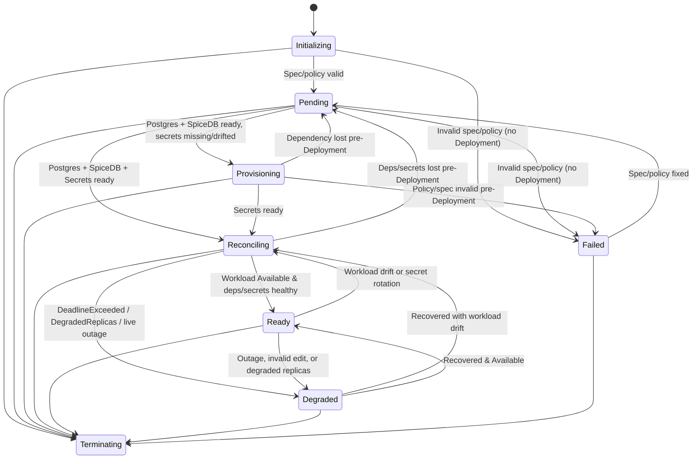

# Waddle Kubernetes Operator (`waddle-operator`)

Kubernetes operator and `WaddleServer` / `WaddleTenant` (`waddle.social/v1alpha1`) CustomResourceDefinitions for deploying and reconciling multi-tenant Waddle XMPP servers cleanly on Kubernetes.

## Design Boundaries

- **Pluggable storage & authorization backends**:
  - **Storage (`spec.storage`)**:
    - **`Turso`**: Local per-tenant Turso/libSQL databases on PVC/emptyDir (`WADDLE_DB_DRIVER=turso`, single-writer `replicas <= 1` and `updateStrategy: Recreate` enforced by CEL; zero CNPG cluster required).
    - **`Postgres`**: CloudNativePG (`postgresql.cnpg.io/v1` `Cluster`) or `External` `Secret` (+ optional `Service`), including Waddle's `restrictedRuntime` (`sslmode=verify-full` + `handoff.json`).
  - **Authorization (`spec.authz`)**:
    - **`OpenFga`**: Observes a same-namespace OpenFGA `Service` + `EndpointSlice` and optional `authSecretRef` (`WADDLE_AUTHZ_BACKEND=openfga`).
    - **`SpiceDb`**: AuthZed SpiceDB Operator (`authzed.com/v1alpha1` `SpiceDBCluster`) with automatic `WADDLE_SPICEDB_INSECURE` detection from `tlsSecretName` and `EndpointSlice` readiness verification, or `External` endpoint.
  - **Broker & Extensions (`spec.broker`, `spec.extensions`)**: Optional credential custody broker with Scaleway Key Manager / Vault / Local KMS and server extensions runtime.
- **`WaddleTenant` multi-tenancy**: Watches `WaddleTenant` (`wt`) resources alongside `WaddleServer`, waits for the referenced `WaddleServer` to reach `Ready`, idempotently provisions the tenant's OpenFGA store (`waddle-tenant-<tenantId>`) and canonical Waddle authorization model, reconciles `waddle-tenant-<cr-name>` + `<server>-tenants` ConfigMaps mounted at `/etc/waddle/tenants`, and cleans up via `waddle.social/tenant-cleanup` finalizer on deletion.
- **`Pending` gate**: Before creating any `Deployment`, `Service`, or `PVC`, `WaddleServer` enters and remains in `Pending` until required storage and authorization dependencies (and any required CRDs) exist and satisfy health readiness (missing CRDs surface cleanly as `CrdNotInstalled` without failing the controller).
- **Non-regressing runtime safety**: Once a live `Deployment` exists (`Reconciling`, `Ready`, `Degraded`), dependency outages, post-admission invalid spec edits, or rollout stalls transition cleanly to `Degraded` — never deleting workloads or regressing back to `Pending` or `Failed`.
- **Secrets management**:
  - **Production default (`ExternalSecrets`)**: Uses External Secrets Operator (`external-secrets.io/v1` preferred, falling back to `v1beta1`), consuming either a pre-existing `ExternalSecret` or an operator-managed `ExternalSecret` (with explicit `--allowed-cluster-secret-stores` policy allowlist).
  - **Opt-in dev quickstart (`Yolo`)**: Requires `--enable-yolo-mode=true` on the controller and strictly enforces single-node safety (`replicas <= 1` and `clustering.enabled: false`). Missing cryptographic keys (`WADDLE_SESSION_KEY`, `WADDLE_OCCUPANT_ID_SECRET`, `WADDLE_DEPLOYMENT_UUID`) are generated once with CSPRNG using `Create` / `409 Conflict` re-read CAS and never rotated or overwritten once present.

## Lifecycle State Machine

Lifecycle transitions are split into two layers inside `crates/waddle-operator-fsm`:

1. Compile-time typestate graph (`StateMachine<S>` + `CanTransitionTo<Next>`), statically forbidding illegal jumps such as `Ready -> Pending` or `Terminating -> *`.
2. Pure convergent `evaluate(from_phase, &ObservedWorld)` producing `(to_phase, commands, conditions, requeue)` with preserved `lastTransitionTime` values.



## Workspace Layout

- `crates/waddle-operator-crd`: `WaddleServer` CRD types, domain newtypes, structural OpenAPI schema + CEL admission rules, pure spec validation, and offline CEL verification tests.
- `crates/waddle-operator-fsm`: Pure zero-I/O typestate and convergent reconciliation state machine with `proptest` invariants and `compile_fail` doctests.
- `crates/waddle-operator`: Controller runtime, capability discovery, scoped same-namespace observers, SSA/CAS executor, resource builders, `Lease`-based leader election, `/healthz` + `/readyz` + `/metrics` server, and in-process mock apiserver integration suite.
- `config/`: Generated CRD YAML (`config/crd/`), full & namespaced & ESO-only least-privilege RBAC (`config/rbac*/`), hardened controller Deployment (`config/manager/`), and sample `WaddleServer` manifests (`config/samples/`).

## CLI & Flags

```sh
# Emit CRD YAMLs
waddle-operator crd > config/crd/waddleservers.waddle.social.yaml
waddle-operator crd --kind tenant > config/crd/waddletenants.waddle.social.yaml

# Run controller (production defaults: --enable-yolo-mode=false, --leader-election=true)
waddle-operator run \
  --metrics-bind=0.0.0.0:8080 \
  --log-format=json \
  --enable-yolo-mode=false \
  --allowed-cluster-secret-stores=vault-backend
```

Important flags:

- `--namespace`: Watch only a single namespace (cluster-wide by default). Never creates an unfiltered Secret informer — owned Secrets are watched only with selector `app.kubernetes.io/managed-by=waddle-operator`.
- `--enable-yolo-mode`: Enables `spec.secrets.mode: Yolo` secret creation (default `false`). Pair `config/rbac-eso-only/` when disabled so the operator ServiceAccount has read-only `get` access on Secrets.
- `--allowed-cluster-secret-stores`: Comma-separated allowlist of `ClusterSecretStore` names usable by operator-managed `ExternalSecret` specs.

## Local Offline Verification

All checks run offline (no live cluster required) inside the Nix dev shell:

```sh
cd operator
nix develop .. -c bash -c "
  cargo fmt --all --check &&
  python3 scripts/check-rust-structure.py &&
  cargo clippy --workspace --all-targets --locked -- -D warnings &&
  cargo nextest run --workspace --all-targets --locked &&
  cargo test --doc --workspace --locked &&
  diff -u config/crd/waddleservers.waddle.social.yaml <(cargo run -p waddle-operator --locked -- crd)
"
```
